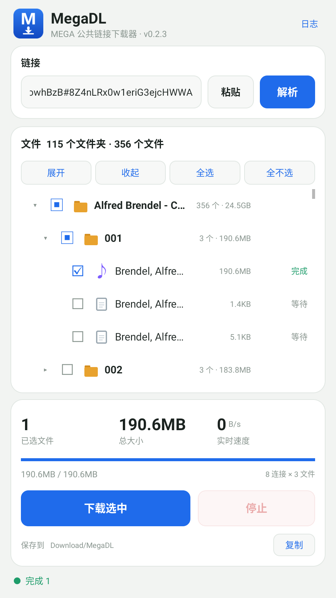

# MegaDL for Android

MEGA 公共链接下载器的安卓原生版，纯 Java + 原生 `Activity` + 编程式布局，
不依赖 Gradle / AndroidX / Kotlin / 第三方库，APK 约 69KB。

桌面版见上级目录 `megadl-rs`（Rust + egui）。



## 功能

- `/file/`、`/folder/`、`#!`、`#F!` 与裸 `id!key` 链接解析，密钥长度按类型校验
- 匿名 g / eu API，属性与节点密钥 AES-CBC / ECB 解密，失败自动换线路重试
- 完整文件夹树：父子句柄、深度缩进、文件夹展开/收起、三态勾选、全选/全不选
- 文件/文件夹大小、类型图标、逐个文件状态（等待 / 直链 / 下载中 / 完成 / 失败 / 已停止）
- 8 连接 × 3 文件并发，4MB 分块 Range 拉取，边收边 AES-CTR 解密写盘
- 分块级重试（120ms 起指数退避 + 抖动，g / eu 主机互换）、停止、重名自动加序号
- 速度约 1.6 秒指数平滑；成功后 `.part` 重命名为最终文件

## 保存位置

公共下载目录 `/storage/emulated/0/Download/MegaDL`，系统文件管理和相册之外的文件浏览器都能直接看到，
卸载应用不会删除文件。文件夹结构按 MEGA 分享里的层级保留。

Android 10 及以上通过 `MediaStore.Downloads` 写入，不需要任何存储权限，下载中的文件对其它应用不可见
（`IS_PENDING`），完成或取消时一次性提交/删除。Android 9 及以下退回公共 Download 目录直写，
需要授予存储权限。

## 构建

需要 JDK 17 与 Android SDK（platform-tools、platforms;android-34、build-tools;34.0.0）。

```powershell
$env:JAVA_HOME   = 'C:\Program Files\Microsoft\jdk-17.0.21.102-hotspot'
$env:ANDROID_HOME = 'C:\Android'
pwsh -NoProfile -ExecutionPolicy Bypass -File android\build.ps1
```

脚本按 `aapt2 → javac → d8 → jar 合并 classes.dex → zipalign → apksigner` 手工出包，
产物 `android\build\MegaDL.apk`，debug 签名（keystore 不存在时自动生成）。

两个注意点：

- `aapt2` 不接受含中文的绝对路径，脚本会先 `Push-Location` 到工程目录再用相对路径。
- `javac` 用 `-bootclasspath android.jar` 编 lambda 会缺 `LambdaMetafactory`，改用 `--release 8 -classpath android.jar`。

## 安装

```powershell
adb install -r android\build\MegaDL.apk
adb shell am start -n com.weizhigao21.megadl/.MainActivity
```

## 版本

v0.2.3 / versionCode 5，minSdk 24，targetSdk 34，申请 INTERNET 权限；
Android 9 及以下额外申请存储权限。下载服务器可能返回 `http://` 直链，清单里开启了 `usesCleartextTraffic`。


