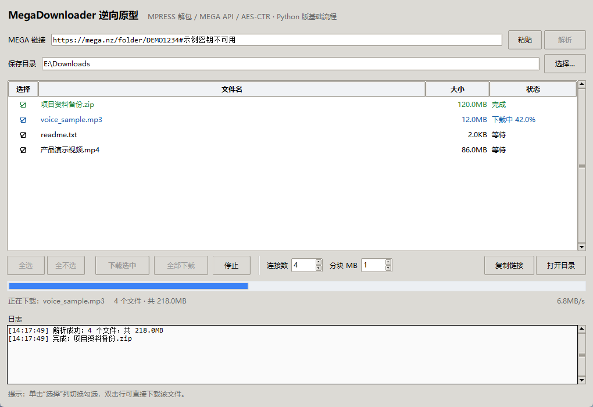

# MegaDownloader 逆向原型（Python）

对 `C:\APP\MegaDownloader\MegaDownloader.exe`（MPRESS 打包的 VB.NET 程序，内部版本 1.8）
做静态逆向后的基础功能复现：解析 MEGA 链接、查询文件信息、AES 解密文件名、
多连接 Range 分块下载并用 AES-CTR 解密文件内容。

## 安装

```powershell
cd "E:\code\MegaDownloader-逆向\mega_proto"
python -m pip install -r requirements.txt
```

## 使用

```powershell
# 查看文件信息（文件名 / 大小 / 下载地址）
python mega.py info "https://mega.nz/file/XXXXXXXX#KEY"

# 下载单个文件（4 连接，1MB 分块）
python mega.py download "https://mega.nz/file/XXXXXXXX#KEY" -o "D:\Downloads" -j 4

# 列出文件夹内容
python mega.py list "https://mega.nz/folder/XXXXXXXX#KEY"

# 下载整个文件夹（扁平输出到目录）
python mega.py download "https://mega.nz/folder/XXXXXXXX#KEY" -o "D:\Downloads"
```

支持的链接形式：

- `https://mega.nz/file/<id>#<key>`
- `https://mega.nz/folder/<id>#<key>`
- `https://mega.nz/#!<id>!<key>`、`https://mega.co.nz/#!<id>!<key>`
- `https://mega.nz/#F!<id>!<key>`、`https://mega.co.nz/#F!<id>!<key>`

## 图形界面（demo）

不依赖额外 UI 库，使用 Python 内置 Tkinter。需要用带 Tk 的 Python 启动
（本机为 `C:\Users\wei\AppData\Local\Programs\Python\Python310\python.exe`）：

```powershell
cd "E:\code\MegaDownloader-逆向\mega_proto"
& "C:\Users\wei\AppData\Local\Programs\Python\Python310\python.exe" mega_gui.py
```



界面流程与功能：

1. 粘贴/输入 MEGA 文件或文件夹链接，点“解析”（回车也可）。
2. 文件夹会列出全部文件（名称、大小），单击“选择”列切换勾选。
3. “下载选中”只下勾选的文件；“全部下载”自动全选后逐个下载。
4. 下载中显示当前文件进度、总进度、速度、每个文件状态，日志区记录过程。
5. 可随时“停止”，当前分块结束后退出，已写入的 `.part` 保留。
6. 其它：保存目录选择、连接数与分块大小设置、复制选中文件的直链、打开下载目录、双击行直接下载。

说明：这是流程演示版，下载按文件串行、文件内部多连接；不做登录、断点续传持久化、
文件夹层级还原等原程序高级能力。

参数说明：

| 参数 | 说明 |
| --- | --- |
| `--eu` | 优先使用 `eu.api.mega.co.nz`（默认 `g.api`，连接失败会自动切换） |
| `-o/--out` | 输出目录 |
| `-f/--out-file` | 指定输出文件路径（仅单文件） |
| `-j/--connections` | 并发连接数，默认 4 |
| `-s/--part-size` | 分块大小（MB），默认 1，必须为 16 的倍数 |

## 与原始程序的对应关系

| 原始程序位置 | 原型实现 |
| --- | --- |
| `Conexion.Get_MEGA_API_Url` / `InternalConfiguration` | `MegaAPI` 的 `API_G` / `API_EU` |
| `Conexion.ObtenerInformacionFichero` | `MegaAPI.file_info`（`{"a":"g","g":1,"ssl":0,"p":...}`；文件夹内文件用 `n=<文件句柄>` + URL `&n=<文件夹ID>`） |
| `MegaFolderHelper.RetrieveLinksFromFolder` | `MegaAPI.folder_nodes`（`{"a":"f","c":1,"r":1}` + `&n=`） |
| `PreSharedKeyManager.DecryptFileInfo` | `decrypt_attrs`（AES-CBC，IV=0） |
| `Criptografia.GetInstaceCipher` | `file_aes_key` + `aes_ctr_decrypt` |
| `SicSeekableBlockCipher.IncrementCounter` | `aes_ctr_decrypt` 里的 `block = offset // 16` |
| `FileDownloader.ChunkDownloader_DoWork` | `Downloader._fetch_part`（Range + 16 字节块解密） |
| `DataPart(size, parts)` | `Downloader` 的分块（16KB 对齐，原型取 1MB 且 16 对齐） |
| `FileDownloader` 的 `.part` 临时文件 | `xxx.part`，完成后重命名 |

## 已实现 / 未实现

已实现：

- 公共文件链接、公共文件夹链接
- 文件属性（文件名）解密
- 多连接 Range 下载、分块 AES-CTR 解密、断点临时文件 `.part`
- 失败重试；`g.api` 不可达时自动切换 `eu.api`
- Tkinter 桌面 UI：链接解析、勾选下载、全部下载、停止、进度/日志

未实现（原程序有、原型刻意省略）：

- 登录账号、会话（`sid`）、预共享密钥
- MegaCrypter / LinkCrypter / YouPaste / EncrypterMega 等第三方加密链接
- 暂停/续传进度持久化、限速、代理设置
- 下载完成后自动解压（原程序内置 SharpCompress）
- 文件夹层级还原（原型扁平输出）

## 测试

```powershell
python selftest.py    # 链接解析、属性解密、CTR 偏移解密
python test_local.py  # 本地假 MEGA 服务的端到端下载测试
python test_gui.py    # 真实 Tk 窗口 + 本地假服务的 UI 下载流程
```

真机 API 连通性：本机网络访问 `g.api.mega.co.nz` 超时，`eu.api.mega.co.nz` 可达，
因此原型默认 `g.api`、失败自动回退 `eu.api`；用不存在的文件 ID 请求可正常收到
MEGA 的 `-9 ENOENT` 错误，说明请求格式与应答解析正确。

## 参考

详细逆向过程、关键 IL 片段与协议字段见上一级目录的 `逆向分析笔记.md`。
